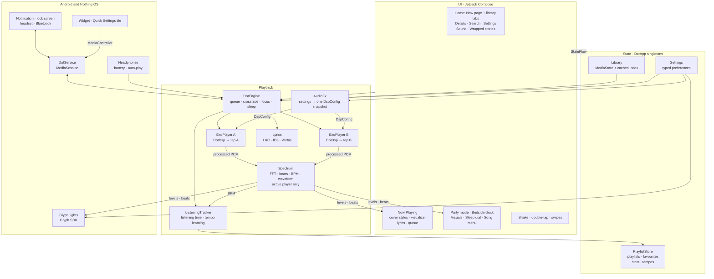
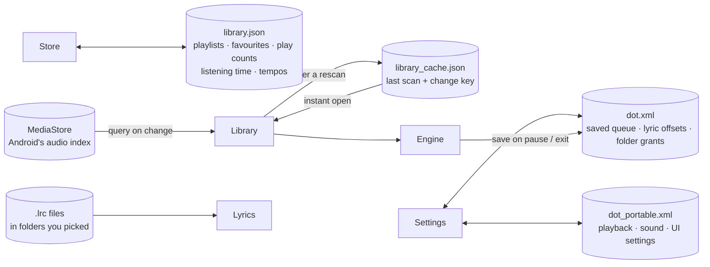
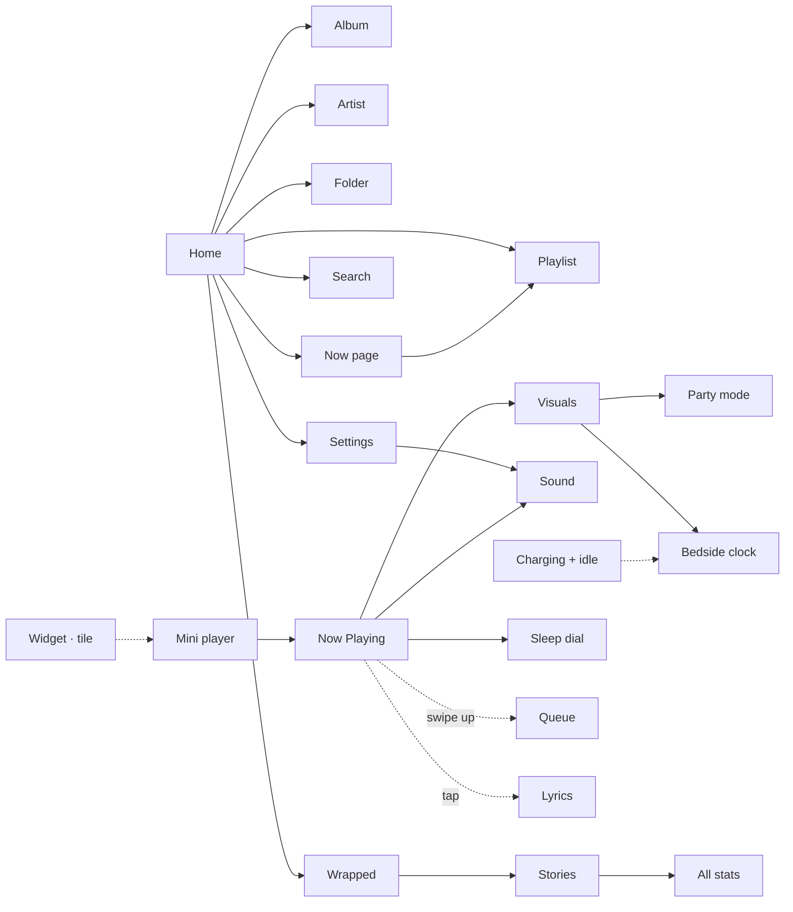
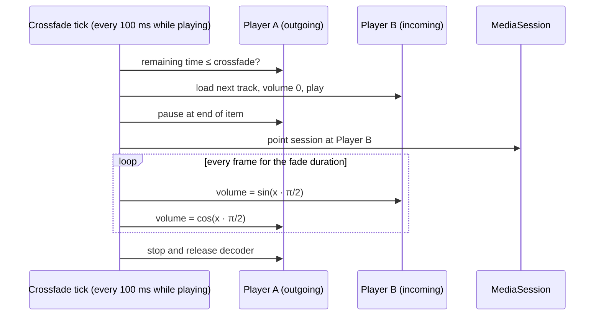
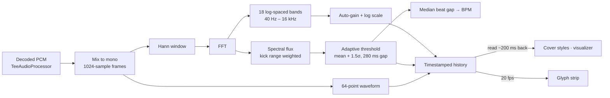
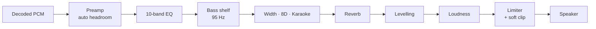

# Dot: offline music player for Nothing Phone and Android

[](https://github.com/dhananjay6561/dot/actions/workflows/build.yml)
[](https://github.com/dhananjay6561/dot/releases/latest)
[](LICENSE)


**Dot is a free, open-source offline music player for Android**, designed around the Nothing OS look: pure black, dot-matrix type and a single red accent. It plays the music files already on your phone, with crossfade, a 10-band equalizer, synced karaoke lyrics and beat-reactive visuals. Built for the Nothing Phone (4a), it runs on any phone with Android 10 or newer, and on Nothing phones it also drives the Glyph lights on the back in time with the music.

<p align="center">
  
</p>
<p align="center"><a href="https://github.com/dhananjay6561/dot/releases/download/v1.2.0/dot-demo.mp4"><b>Watch the full demo in 1080p</b></a></p>

<p align="center">
  
  
  
  
</p>

Dot plays the music that lives on your phone. No accounts, no streaming, no ads, no network calls.

### At a glance

| | |
| --- | --- |
| What it is | An offline music player for local files (MP3, FLAC, ALAC, WAV, AAC, Opus, Vorbis) |
| Price | Free, no ads, no in-app purchases |
| License | Open source, Apache 2.0 |
| Works on | Any Android phone with Android 10 or newer; Glyph lights on the Nothing Phone (4a) |
| Internet | None. Dot has no internet permission at all |
| Download size | **3.8 MB** (most streaming music apps install at well over 100 MB) |
| Latest version | 1.3.0, from [GitHub Releases](https://github.com/dhananjay6561/dot/releases/latest) |

## Why Dot

Most Nothing-styled players restyle a regular player. Dot is built around Nothing's design and hardware from the ground up:

- **The Glyph strip is part of the player.** Meter, Pulse and Progress modes with brightness, sensitivity and beat flash, plus a live on-screen mirror of the lights.
- **It has its own sound engine.** Eight sound modes, a 10-band EQ, a limiter that stops boosted sound crackling, volume levelling, balance, and Vibes like 8D, Karaoke, Slowed + Reverb and Nightcore. It sounds the same on every phone.
- **It shows the music.** Dot art, Halo and a scratchable Vinyl cover, Grid, Mirror and Wave visualizers, and a Party mode that builds its landscape from the song itself.
- **Transitions feel mixed, not cut.** Crossfades start on the beat.
- **Every detail is dot matrix.** Dot sliders, an analog sleep dial, karaoke lyrics and a bedside clock, all in Nothing's black, white and red.
- **It knows how you listen.** A Now page with what's next, your mood mixes and your most played songs, mixes that learn each song's tempo, and Wrapped stats told as tap-through stories.
- **It moves like one piece.** The cover grows out of the mini player into Now Playing, the screen glows in the cover's colour, and the play button pulses on the beat.

All of it in a **3.8 MB download**, fully offline, with no accounts and no internet permission.

## Download

Grab **`Dot-1.3.0.apk`** from the [latest release](https://github.com/dhananjay6561/dot/releases/latest), open it on your phone and allow installing from that source. Android 10 or newer.

> **Coming from 1.2.x?** 1.3.0 installs over it in place and keeps your playlists, favourites and stats.
>
> **Coming from 1.0 or 1.1?** From 1.2.0 Dot is signed with its own release key, so it can't update the older build in place. Back up first (**Settings → Back up**), uninstall the old Dot, install 1.3.0, then **Settings → Restore**. Later updates install in place again.

## What's new in 1.3.0

- **A Now page** opens the library: up next from your queue, your Chill, Groove and Hype mixes, most played, recently added and your Wrapped minutes.
- **Now Playing reacts to the song.** A dotted glow in the cover's colour, a play button that pulses on the beat, and a live mirror of the Glyph lights under the visualizer.
- **Smoother motion.** The cover grows out of the mini player, screens settle in on a spring, one indicator slides between the library tabs, and taps on play, like, tabs and the queue get a haptic tick.
- **Wrapped as stories.** Tap through your minutes, top artist, top song, listening clock and listener type, then share the summary card.
- **Cleaner library.** Songs without a cover get their own dot pattern, titles that start with a number sort after the alphabet, and counts read "1 song" instead of "1 songs".
- **Calmer colour.** Red now marks only what's live, like the playing song and the seek head; switches and controls are white, and the playlist and Now Playing icons are drawn in dots.

See the [full release notes](https://github.com/dhananjay6561/dot/releases/tag/v1.3.0).


## Features

**Playback**
- Crossfade between tracks on an equal-power curve, adjustable from off to 12 seconds
- Blends start on the beat: Dot listens to the end of each song and drops the next one on a beat
- Short blend when skipping, soft fade on play and pause
- Gapless playback when crossfade is off
- Shuffle, repeat all, repeat one, playback speed from 0.5x to 2x
- Queue editing: play next, add to queue, reorder, remove
- Picks up where you left off: queue, track and position survive restarts
- Swiping Dot away from recents stops the music
- Starts your queue when headphones connect (Bluetooth, wired or USB)

**Sleep timer**
- Analog dial: drag the knob around the face, one turn per hour, up to three hours
- Each hour fills its own ring of dots, with the stop time shown in the middle
- Quick presets, "end of this song", and a gentle fade out before stopping

**Sound** (Dot's own audio engine, the same on every phone)
- One-tap sound modes: Hi-Fi, Bass Boost, Super Bass, Panoramic, Concert, Vocal, Club, Cinema
- 10-band equalizer from 31 Hz to 16 kHz (±12 dB) with nine presets and per-band dot sliders
- A true low-shelf bass boost, mid/side stereo widening (Panoramic) and room reverb (Room, Studio, Hall, Arena, Plate)
- Automatic headroom and a peak limiter, so boosted settings never clip or crackle
- Left/right balance and a mono switch, for one earbud or uneven hearing
- Volume levelling, so quiet and loud tracks play at a similar level
- **Vibes:** Slowed + Reverb, Nightcore, 8D (the song circles your head) and Karaoke (vocal remover)
- Lossless formats: FLAC, ALAC, WAV, plus Opus, Vorbis, MP3 and AAC; surround files play untouched
- Every change glides in over about 15 ms, so dragging a slider never clicks

**Visuals**
- Three cover styles, switched by tapping the art:
  - **Cover:** the album art; wide or tall covers are shown in full over a blurred fill
  - **Dot art:** the cover redrawn as a colour halftone that swells and ripples on every beat
  - **Halo:** a round cover with dot spokes following the spectrum and red rings rippling out on beats
  - **Vinyl:** a spinning record at 33⅓ RPM with dotted grooves and a tonearm that tracks progress; grab it to scratch through the song
- Three visualizer styles, switched by tapping the strip: **Grid**, **Mirror** and **Wave**
- Real-time beat detection with a live BPM readout
- Now Playing glows in the cover's colour: a dotted halo, picked once per album, that fades ring by ring and crossfades between songs
- The play button pulses gently on every beat
- A Visuals panel with live previews of every style, rendered from the song that's playing
- **Party mode:** a full-screen landscape scene in dots: a red sun on the horizon, a spectrum skyline, a floor that rushes towards you at the song's tempo, and sparks on every beat
- **Bedside clock:** a big dot-matrix clock with what's playing; opens by itself on the charger after a minute untouched, dims, and shifts slightly so the OLED never burns in

**Glyph lights** (Nothing Phone (4a))
- The rear light strip reacts to the music:
  - **Meter:** the six LEDs climb with the bass, with smooth per-LED brightness
  - **Pulse:** the whole strip flashes on every beat
  - **Progress:** the strip fills as the song plays
- Brightness, sensitivity and beat-flash controls, with a live on-screen mirror of the strip in the Visuals panel and under the visualizer on Now Playing
- Controlled from the Glyph button on Now Playing or from Settings

**Lyrics**
- Synced `.lrc` files and lyrics embedded in ID3 or Vorbis tags
- Karaoke fill: the current line lights up left to right as it's sung, including wrapped lines
- The current line stays in focus with smooth scrolling and fading neighbours
- Breathing dots during instrumental breaks
- Tap any line to jump there; scroll freely and it re-syncs on its own
- Per-song timing offset for files that run early or late
- Finds `.lrc` files even when their names don't match the song file exactly
- Reads `.lrc` files only from the folders you pick in Settings, with no all-files access

**Library**
- A **Now** page first: up next from your queue, mood mix cards, most played, recently added and your Wrapped minutes, each with a link to the full list
- Songs, albums, artists, folders and playlists
- Favourites, Recently added and Most played lists
- Mood mixes: Dot learns each song's tempo on its first play and sorts it into **Chill**, **Groove** or **Hype**
- Search across songs, albums and artists
- Fast scroller with a letter bubble on long lists
- Titles that start with a number or symbol sort after the alphabet, in a # group, like other players
- Songs without a cover get their own mirrored dot pattern, made from the title, so they're easy to tell apart
- Cleans download-site junk from tags for display, such as "(DjPunjab.CoM)", "- PagalNew" or "320 Kbps"; files are never modified
- Hides WhatsApp voice notes and clips below a minimum length
- Opens instantly from a cached index and only rescans when Android reports a change

**Dot Wrapped**
- Opens as full-screen stories: tap the right side for the next card, the left for the one before; each moves on by itself after five seconds
- Total listening time that counts up, top artists, top songs and a day streak
- A listening clock showing when in the day you listen, and the last seven days
- A listener type (Early bird, Daydreamer, Evening soul, Night owl)
- A summary card you can share as an image, and **All stats** for every chart on one page

**Gestures**
- Double-tap the art to like, with a heart burst
- Swipe the art sideways for next or previous, swipe up for the queue, swipe down to close
- Shake the phone back and forth for a random song

**Feel**
- The cover grows out of the mini player into Now Playing and shrinks back when you close it
- New screens settle in on a soft spring; one white indicator slides between the library tabs as you swipe
- Haptic ticks on play and pause, liking a song, switching tabs and moving songs in the queue
- Nothing-style dot-matrix sliders that grow under your finger, with value bubbles and haptic ticks
- Buttons and pills squish on press, icons scale and cross-fade when they change, colours fade between states
- Liking a song pops the heart
- Red is kept for what's live, like the playing song, the seek head and beats; switches and controls stay black and white
- Two-pane Now Playing in landscape; sheets open fully and scroll on short screens

**Earphones**
- Shows the connected Bluetooth earphones and the battery level they report, on the Sound screen and as a chip on Now Playing
- Android gives regular apps one overall level; separate left, right and case levels are reserved for system apps

**Widget and tile**
- Home-screen widget with the cover, the title in dot type, play/pause and next
- Quick Settings tile to play or pause from the notification shade, showing the current song
- Both work even when Dot isn't open

**Backup**
- Back up playlists, favourites, play counts, listening stats and learned tempos to a file, and restore them later
- **Privacy:** exported backups include full music file paths (folder names and file names) and listening statistics. Keep the file private and review it before sharing.
- Songs are matched by file path, then by title and artist, so a backup survives a phone reset or a new phone
- A restore is checked in full before anything changes, and the data it replaces is kept as `library.json.before-restore`
- Android system backup and phone transfer carry only portable settings; use the manual export for playlists and listening statistics

**System**
- Keeps playing in the background and with the screen locked
- Lock-screen and notification controls with album art
- Headset and Bluetooth buttons, pauses for calls, ducks for navigation, pauses when headphones disconnect

## Screenshots

### Library

<table>
<tr><td align="center"><br><sub>Songs</sub></td><td align="center"><br><sub>Albums</sub></td><td align="center"><br><sub>Playlists and mood mixes</sub></td></tr>
</table>

### Cover styles

<table>
<tr><td align="center"><br><sub>Cover</sub></td><td align="center"><br><sub>Dot art</sub></td><td align="center"><br><sub>Halo</sub></td><td align="center"><br><sub>Vinyl</sub></td></tr>
</table>

### Visualizers and Glyph

<table>
<tr><td align="center"><br><sub>Mirror visualizer</sub></td><td align="center"><br><sub>Wave visualizer</sub></td><td align="center"><br><sub>Visuals and Glyph panel</sub></td></tr>
</table>

### Sound

<table>
<tr><td align="center"><br><sub>Sound modes</sub></td><td align="center"><br><sub>Equalizer and enhancements</sub></td></tr>
</table>

### Player tools

<table>
<tr><td align="center"><br><sub>Queue</sub></td><td align="center"><br><sub>Analog sleep timer</sub></td><td align="center"><br><sub>Search</sub></td></tr>
</table>

### Dot Wrapped and settings

<table>
<tr><td align="center"><br><sub>Wrapped summary</sub></td><td align="center"><br><sub>Top songs and listening clock</sub></td><td align="center"><br><sub>Settings</sub></td></tr>
</table>

### Party mode and bedside clock

<table>
<tr><td align="center"><br><sub>Party mode</sub></td>
<td align="center"><br><sub>Bedside clock</sub></td></tr>
</table>

## FAQ

### Is Dot free?
Yes. Dot is free and open source under the Apache 2.0 license, with no ads, no in-app purchases and no account.

### Does Dot need an internet connection?
No. Dot has no internet permission, so it cannot connect to the network at all. It plays music files that are already on your phone.

### Does Dot work on phones that aren't made by Nothing?
Yes. Dot runs on any Android phone with Android 10 or newer. Only the Glyph light features need a Nothing Phone (4a); everything else, including the Nothing-style design, works everywhere.

### How do I make the Nothing Glyph lights react to music?
Open Now Playing, tap the Visuals button (the dotted bars at the top) and pick a Glyph mode: **Meter** climbs with the bass, **Pulse** flashes on every beat and **Progress** fills as the song plays. You can also set it from Settings.

### Which audio formats does Dot play?
MP3, AAC, FLAC, ALAC, WAV, Opus and Vorbis. Lossless files play untouched, and surround files skip the effects chain instead of failing.

### Does Dot show synced lyrics?
Yes. Dot reads synced `.lrc` files and lyrics embedded in ID3 or Vorbis tags, and fills the current line left to right as it is sung, karaoke style. Pick your lyrics folders under **Settings → Lyrics folders**.

### Does Dot have an equalizer?
Yes, its own: a 10-band equalizer from 31 Hz to 16 kHz with nine presets, eight one-tap sound modes, bass boost, stereo widening, reverb, volume levelling and a limiter that stops boosted sound from crackling. It sounds the same on every phone because it doesn't rely on the phone's built-in effects.

### Can Dot stream from Spotify or YouTube Music?
No. Dot is a player for local music files only, by design.

### How do I move my playlists and stats to a new phone?
Use **Settings → Back up** on the old phone and **Settings → Restore** on the new one. Songs are matched by file path first and then by title and artist, so playlists, favourites, play counts and learned tempos carry over.

### How big is Dot?
About a 3.8 MB download. Release builds are shrunk with R8 and ship only English resources and the code the app uses.

## Architecture

Dot is a single-module app in four layers. Data flows up as `StateFlow`; commands flow down as plain method calls on a few app-wide singletons created in `DotApp`.



- **The UI never touches ExoPlayer.** Screens read `StateFlow`s and call methods on `DotEngine`, which owns both players.
- **One code path for every control.** `DotService` wraps the engine in a Media3 `MediaSession`, so the notification, lock screen and headset buttons drive exactly the same methods as the app's buttons.
- **The analyser is shared and reference-counted.** Visuals, the Glyph strip and tempo learning each acquire `Spectrum` while they need it. It does no work when nobody holds it, skips the waveform when only the strip and tempo learning listen, and on-screen visuals let go of it as soon as Dot leaves the screen.
- **Each player has its own tap.** Only the active player's audio reaches the analyser, so a crossfade never blends two songs into one beat track.
- **Settings cross threads as one snapshot.** `AudioFx` turns the sound settings into an immutable `DspConfig` and publishes it in a single write; each player's `DotDsp` reads it once per buffer.
- **Overlays are plain composables.** Party mode, the bedside clock and the sheets sit on top of the navigation stack in `Root`, so they keep their own state and close with back.
- **One shared cover.** `Root` wraps the app in a `SharedTransitionLayout`, so the mini player art and the Now Playing cover are one shared element. The bedside clock sits outside it, so the animation never draws over the clock.

### Data and persistence

Dot has no database. Everything persists in four small files and Android's own media index:



- **Opening the app:** the library loads from `library_cache.json` straight away, then Dot compares MediaStore's change counter and filters with the cached key and only re-queries if something changed.
- **While playing:** listening time is written at most once a minute; a song's tempo is written once, after its first play.
- **Writes are debounced and atomic:** `library.json` goes through `AtomicFile` on a single writer thread: it is synced to disk before it replaces the old file, and two saves can never overlap.
- **Damage is recoverable:** each session keeps the file it started with as `library.json.prev` and falls back to it if the main file can't be read. An unreadable file is kept aside as `library.json.corrupt` rather than written over, and each section loads on its own so one bad field doesn't cost the rest.
- **Restores are all or nothing:** a backup is read with a 5 MB cap, parsed and checked off the main thread, and only then swapped in, with the replaced data saved as `library.json.before-restore`.
- **Lyrics files** are read through the Storage Access Framework from folders you grant, never through all-files access.

### Screens and overlays



## How crossfade works

A single ExoPlayer can't play two tracks at once, so Dot runs two. The active player holds the whole queue, which keeps gapless playback and notification controls working natively. When a fade begins, the spare player loads the next track and the roles swap.



- **Equal-power curve.** Sine in, cosine out keeps perceived loudness constant through the blend, where a linear fade dips in the middle.
- **Waits for the decoder.** The fade clock only starts once the incoming track is ready, so the first beat isn't lost.
- **Interruptible.** Skipping mid-fade cuts the old outgoing track and fades out from whatever volume the current one has reached.
- **One audio focus owner.** The engine requests focus itself. Two players requesting it separately would pause each other.
- **One audio session.** Both players share a session ID, so the equalizer applies to both sides of a fade.
- **The analyser follows the incoming song.** When the roles swap, the beat tracker switches to the new player, so the blend's beats and tempo belong to one song.

## How the visualizer, beats and Glyph lights work

Most Android visualizers need microphone permission. Dot taps the decoded audio straight out of ExoPlayer instead, so it needs no extra permission and only hears the music.



- **Levels.** Each 23 ms frame becomes 18 frequency bands, normalised against a slowly decaying peak so quiet and loud tracks both fill the grid.
- **Beats.** Spectral flux measures how much energy *rose* since the previous frame, mostly in the 30 to 180 Hz kick range. A beat fires when that rise clears the recent average by a margin, with a refractory gap so one hit can't fire twice. The median gap between beats gives the BPM.
- **Sync.** Audio is decoded ahead of the speaker by the output buffer. Every frame is timestamped and readers take the one that is audible now, not the one just decoded.
- **Tempo learning.** Beats are timed as the audio plays, so under Slowed, Nightcore or a custom speed the measured tempo is scaled back to the song's own before it is saved.
- **Glyph strip.** The low bands drive a six-LED meter with per-LED brightness, beats flash the whole strip, and frames are only sent over the binder when they visibly change.

## How the sound engine works

Android's built-in effects differ from phone to phone, so Dot processes audio itself, inside each player, before it reaches the speaker:



- **Headroom first.** The preamp pulls the signal down by most of the biggest boost, so the EQ and bass shelf can't overload. The limiter catches whatever is left, and a soft clip rounds off any final peak instead of crackling.
- **Filters** are standard RBJ biquads; bands set to 0 dB are skipped entirely.
- **No clicks, no allocations.** When a setting changes, filter coefficients glide to the new design over about 15 ms (interpolating stays stable because the stable region is convex), and preamp, loudness, width, reverb mix, balance and mono are smoothed per sample. Reverb delay lines are sized once per sample rate and only retuned, so the tail carries on through an EQ edit and nothing is allocated on the audio thread.
- **Surround passes through.** Files with more than two channels skip the chain instead of failing.
- **Panoramic** widens the side signal; **8D** pans the centre slowly around your head; **Karaoke** keeps the sides and only the low end of the centre, where most vocals sit.
- **Slowed + Reverb** and **Nightcore** change speed and pitch together, like a record at the wrong speed, with a big room added for Slowed.
- Both crossfading players run their own copy of the chain from shared settings, so effects carry straight through a blend.

## Performance

Dot is built to stay light on battery and memory:

- The engine tick runs only while music plays and sleeps completely when paused.
- Visuals render at most 60 fps, even on 120 Hz screens, and stop once the music is paused and the dots have settled.
- Dot art paints its halftone once into a bitmap; each frame only scales it and lights the ripple band.
- The analyser runs only while a visual or the Glyph strip is using it, and visuals release it when Dot leaves the screen; the waveform is skipped when only the strip listens.
- Changing a sound setting allocates nothing on the audio thread; settings are read once per buffer from an immutable snapshot.
- Songs don't each hold a `Uri`; it is built from the id only when art or sharing needs it.
- Analyser buffers are reused instead of reallocated on every frame.
- Listening stats are written once a minute and on pause, not continuously.
- The library opens from a cached index and only rescans when MediaStore's change counter moves.
- Album art comes from `ContentResolver.loadThumbnail` with an in-memory LRU cache, with no image library.
- Only the parts that change every frame update: the seek bar, the lyric fill, the beat dot, the play button's beat pulse and the sliding tab indicator repaint without rebuilding the screen.
- Now Playing runs one beat analyser for the cover, the strip and the play button, and only while the cover is showing.
- The cover glow colour is read once per album from a small thumbnail, off the main thread; its dot positions are worked out once per screen size, so a new song only repaints them.
- The current lyric line is found by binary search; queue edits change the list in place instead of rebuilding it.
- Analyser frame lookups walk back from the newest frame and beat statistics are kept as running sums.
- Search is debounced and matched off the main thread.
- Album art is cached in three size buckets; vinyl grooves are a one-byte alpha mask.
- Tempo is learned once per song from its first 25 seconds, then never measured again.
- Release builds are shrunk and optimised with R8: a 3.8 MB download and 3.9 MB installed.
- Only English resources, arm64 native code and the audio extractors a music library needs are packaged.
- Fonts are subset to Latin, and the Doto variable font is frozen to the one style Dot uses.

## Tech stack

| Area | Choice |
| --- | --- |
| Language | Kotlin |
| UI | Jetpack Compose, Material 3 (restyled) |
| Playback | AndroidX Media3 ExoPlayer and MediaSession |
| Audio processing | Dot's own DSP chain inside ExoPlayer: RBJ biquad EQ and shelf, mid/side width, Freeverb-style reverb, RMS levelling, peak limiter |
| Glyph | Nothing Glyph Developer Kit |
| Library | MediaStore with a content observer and a cached index |
| Storage | SharedPreferences and JSON files, no database |
| Fonts | Doto (dot matrix) and Space Mono |

## Project structure

```
app/src/main/java/com/dj/dot
├── DotApp.kt              app singletons
├── MainActivity.kt        edge-to-edge host, binds the media controller
├── data/
│   ├── Models.kt          Song, Album, Artist, Folder, Playlist, library sorting
│   ├── Library.kt         MediaStore scan, cache and auto-rescan
│   ├── TagCleaner.kt      strips download-site junk from tags
│   ├── PlaylistStore.kt   playlists, favourites, play counts, listening stats
│   └── Settings.kt        typed preferences as StateFlows
├── playback/
│   ├── DotEngine.kt       dual-player engine, crossfade, focus, queue
│   ├── ListeningTracker.kt listening time and tempo learning
│   ├── DotService.kt      media session service and notification art
│   ├── DotDsp.kt          the audio chain: EQ, bass, width, 8D, karaoke, reverb, levelling, limiter
│   ├── AudioFx.kt         maps sound settings, presets and modes onto the chain
│   ├── Spectrum.kt        FFT, bands, beats, BPM, waveform
│   ├── GlyphLights.kt     rear light strip modes
│   ├── Headphones.kt      connected earphones and their battery level
│   └── Lyrics.kt          LRC, ID3 USLT and Vorbis lyrics, lrc matching
└── ui/
    ├── Theme.kt           colours and type
    ├── Components.kt      pills, sliders, art, fast scroller, press animations
    ├── DotIcons.kt        dot-matrix icons for Visuals, playlists, moods, folders and Now Playing
    ├── DotPattern.kt      mirrored dot patterns for songs without a cover
    ├── Plural.kt          "1 song", "2 songs"
    ├── Root.kt            navigation, permissions, mini player, shared cover transition
    ├── Home.kt            library tabs and the sliding tab indicator
    ├── NowTab.kt          the Now page: up next, mood mixes, most played, recent
    ├── Details.kt         album, artist, folder, playlist
    ├── NowPlaying.kt      player, cover glow, beat pulse, queue, sleep sheet
    ├── Visualizers.kt     grid, mirror, wave, dot art, halo
    ├── VisualsSheet.kt    visuals and Glyph panel with live previews
    ├── VinylViz.kt        spinning record with scratch to seek
    ├── PartyMode.kt       full-screen landscape visualizer
    ├── BedsideMode.kt     night-stand clock
    ├── ShakeToShuffle.kt  shake gesture
    ├── LyricsView.kt      karaoke lyrics
    ├── SleepDial.kt       analog sleep timer
    ├── WrappedScreen.kt   listening stats and Wrapped stories
    ├── SearchScreen.kt
    ├── SettingsScreen.kt  settings and the sound screen
    └── Sheets.kt          song menu, playlist picker, dialogs
└── widget/
    ├── DotWidget.kt       home-screen widget
    ├── DotTileService.kt  Quick Settings tile
    └── RemoteControl.kt   sends widget and tile commands through the media session

app/src/test/java/com/dj/dot   JVM unit tests: store, restore, library sorting, lyrics, tags, DSP, tempo, counts, cover patterns
```

## Building

Requirements: JDK 17 or 21 and the Android SDK (platform 36).

```bash
git clone https://github.com/dhananjay6561/dot.git
cd dot
echo "sdk.dir=/path/to/android/sdk" > local.properties
./gradlew assembleDebug
```

The first build downloads the Nothing Glyph SDK from a pinned commit of its [official repository](https://github.com/Nothing-Developer-Programme/Glyph-Developer-Kit) into `app/libs/`, since it isn't published to Maven, and fails if its SHA-256 doesn't match.

Checks that CI runs on every push and pull request:

```bash
./gradlew lintRelease          # NewApi is fatal: anything above Android 10 must be guarded
./gradlew testDebugUnitTest    # JVM unit tests
./gradlew assembleRelease      # R8-shrunk release build
```

**Release builds** are never signed with the debug key. Without signing details `assembleRelease` gives an unsigned APK; see [CONTRIBUTING](CONTRIBUTING.md#release-builds) for the keystore and the Nothing Glyph API key.

## Installing on a phone

1. Enable Developer options: **Settings → About phone → tap Build number 7 times**.
2. Turn on **USB debugging** or **Wireless debugging** in Developer options and connect the phone.
3. Run:

```bash
./gradlew installDebug
```

Debug builds install as a separate app, `com.dj.dot.debug`, next to a release install, so testing never touches your real library or stats. `installRelease` works once release signing is set up. Or copy the APK to the phone and open it, allowing installs from that source when asked.

### Recommended on first launch

- Allow music access when prompted.
- **Settings → Keep playing in background** exempts Dot from battery optimisation, so the system never stops playback.
- **Settings → Lyrics folders** is only needed if you keep `.lrc` files next to your songs: pick the folders and Dot gets read access to those alone.
- On a Nothing Phone (4a), open the Visuals button on Now Playing and pick a Glyph light mode.
- Long-press your home screen to add the Dot widget, and edit Quick Settings to add the Dot tile.

## Permissions

| Permission | Why |
| --- | --- |
| `READ_MEDIA_AUDIO` | Read your music |
| `POST_NOTIFICATIONS` | Playback notification |
| `FOREGROUND_SERVICE_MEDIA_PLAYBACK` | Keep playing in the background |
| `WAKE_LOCK` | Don't stall with the screen off |
| `com.nothing.ketchum.permission.ENABLE` | Drive the Glyph lights on Nothing phones |
| `BLUETOOTH_CONNECT` | Optional, asked from the Sound screen, to show the earphones' battery |
| `REQUEST_IGNORE_BATTERY_OPTIMIZATIONS` | Optional, asked from Settings |

Dot has no internet permission and no all-files access. `.lrc` files are read only from folders you choose in the system folder picker, which needs no permission.

Android's system backup can still copy Dot's portable playback, sound and UI settings off the phone, but cloud backup requires client-side encryption; direct device transfer is also allowed. Playlists, favourites, listening history, learned tempos, the song-path cache, saved queue, lyric offsets and folder grants are excluded from both. To move playlists and listening data to a new phone, use **Settings → Back up / Restore**, which matches songs by path or title and artist.

## Roadmap

- Glyph Composer: tap along to a song to record your own light show for the strip
- Guess the Song: a five-second-clip quiz from your own library
- Lyric cards: share any lyric line as a dot-matrix image
- Sunrise alarm with the Glyph strip slowly brightening

## Contributing

Bug reports, ideas and pull requests are welcome. Read the [contributing guide](CONTRIBUTING.md) first. If you work with an AI coding agent, point it at [AGENTS.md](AGENTS.md), which holds the rules it must follow; this project follows the [Contributor Covenant](CODE_OF_CONDUCT.md). Security problems go through the [security policy](SECURITY.md), not public issues.

## Credits

- [Doto](https://fonts.google.com/specimen/Doto) and [Space Mono](https://fonts.google.com/specimen/Space+Mono), both under the SIL Open Font License
- [AndroidX Media3](https://github.com/androidx/media)
- [Nothing Glyph Developer Kit](https://github.com/Nothing-Developer-Programme/Glyph-Developer-Kit)
- Library and queue ideas inspired by open-source players such as Auxio

## License

Dot is licensed under the [Apache License 2.0](LICENSE). Bundled fonts are under the SIL Open Font License; see [NOTICE](NOTICE) for third-party attributions.
